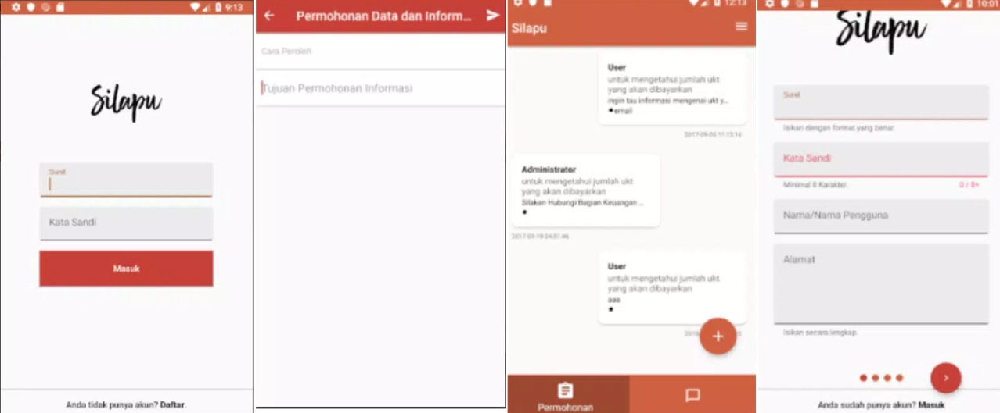

- [x] Historical Production Deployment (Android 4.2+ KitKat to Modern)
- [x] Archive Version Cataloged on [APKPure](https://apkpure.com/id/layanan-dan-pengaduan-ulm-2-0/com.unlam.humas.silapu)
- [x] Institutional Server Decommissioned

## Overview

Sistem Pelayanan dan Pengaduan ULM (Silapu) is the official mobile service request and complaint management application developed for Universitas Lambung Mangkurat (ULM). Prior to its introduction, students and university stakeholders submitted institutional grievances and service requests through paper submissions or legacy desktop portals.

Developed in collaboration with the campus developer initiative, Silapu was deployed to the Google Play Store as a mobile channel for submitting, tracking, and resolving university-wide service tickets directly from Android devices.

## Architecture and Technical Implementation

### 1. Android Client Architecture

The mobile client was engineered using native Android Java with early Kotlin module adoption:

- **Networking Pipeline**: Implemented using Retrofit 2 and OkHttp via a centralized `ApiGenerator` and `ApiInterface` contract layer, handling asynchronous JSON serialization against the university backend.
- **UI & Navigation Controls**: Multi-tab navigation utilizing custom `LockableViewPager`, `CustomScrollAwareBehavior` for collapsible app bar coordination, and non-predictive `NpaLinearLayoutManager` to eliminate layout animation stutter during heavy ticket list updates.
- **State & Session Persistence**: Device credentials and user roles are persisted securely through `UserPreference` wrappers.

### 2. Core Functional Modules

- **Authentication & User Management**: Role-based access control distinguishing university students, faculty members, and institutional administrative reviewers.
- **Complaint Submission & Attachment Pipeline**: Multi-part form data submission allowing users to submit detailed complaint descriptions paired with photographic evidence and geotagged metadata.
- **Ticket Lifecycle & Notification Pipeline**: Status tracking for open, in-review, and resolved complaints with push notification updates on ticket milestone transitions.
- **Document Requests (_Perdata_)**: Standardized request workflow for academic records, student administrative certificates, and faculty verifications.

## Repository

::github{repo="miftahulmuhaemen/silapu_ptik"}
