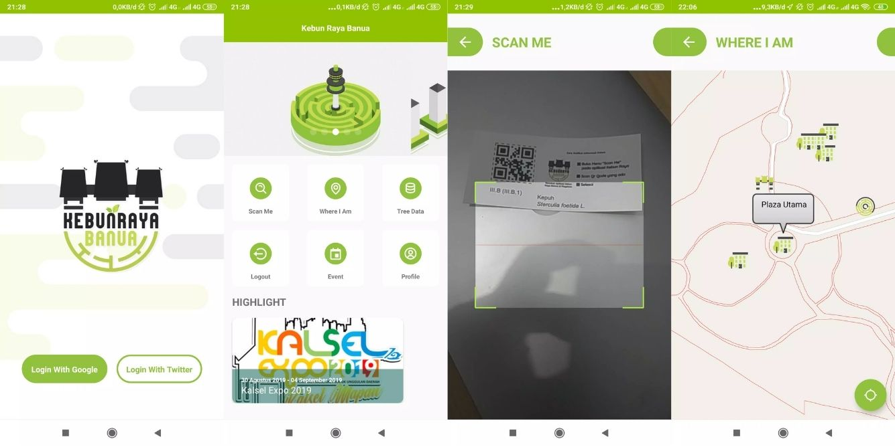
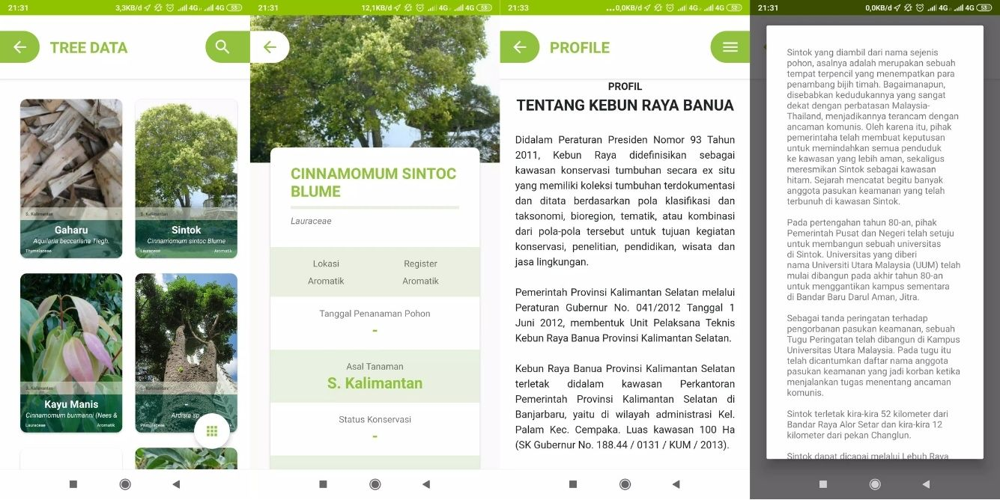

- [x] Historical Production Deployment (Android 5.0+ Lollipop)
- [x] Archive Version Cataloged on [APKPure](https://apkpure.com/id/kebun-raya-banua/com.iqromaya.kebunrayabanua)
- [x] Client Server Decommissioned

## Overview

Kebun Raya Banua is a provincial botanical garden in South Kalimantan dedicated to regional plant conservation, scientific education, and public recreation. Visitors exploring the expansive grounds often struggled to identify rare plant species or locate specific botanical zones without physical tour guides.

The Kebun Raya Banua mobile application was engineered as an on-site digital companion. It combines QR barcode identification plaques, GPS geolocation mapping, and an electronic botanical registry to provide self-guided educational exploration for park visitors.

## Architecture and Technical Implementation

### 1. MVP Architectural Structure

The Android client was developed using Kotlin and structured on the Model-View-Presenter (MVP) pattern:

- **Decoupled Business Logic**: Presenters (`MainPresenter`, `TreeDataPresenter`, `WhereIamPresenter`) coordinate interactions between the UI layer and data services, keeping activity code clean and testable.
- **RESTful Data Communication**: Retrofit 2 client abstraction via `RetrofitFactory` and `RetrofitService` communicates with the municipal botanical backend.

### 2. On-Site Hardware and Environmental Features

- **Hardware Camera QR Scanner**: Integrated camera barcode scanner (`ScanMeActivity`) allows visitors to scan QR codes attached to physical plant tags, immediately retrieving botanical classification, origin, and ecological conservation status.
- **Botanical Registry**: Searchable electronic database (`TreeDataActivity`, `DataTree`) providing taxonomic classifications, scientific nomenclature, medicinal uses, and photo galleries.
- **Where I Am Geolocation**: Geolocation module (`WhereIamActivity`) leveraging the Google Maps Android API to render visitor coordinates relative to key garden zones, pavilions, and conservatory facilities.
- **Events & Exhibition Schedule**: Interactive calendar (`EventActivity`, `DetailEventActivity`) listing park conservation seminars and public exhibits.

## Repository

::github{repo="miftahulmuhaemen/KebunRayaBanua"}
