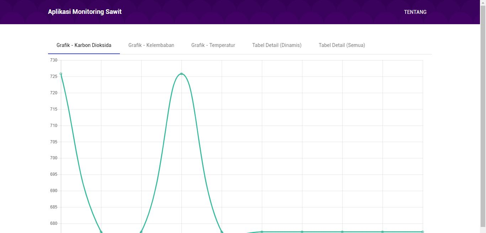

- [x] National Innovation Competition — 2nd Place Winner
- [x] Production Demonstration Deployed on Google Cloud Platform (Compute Engine)
- [x] Experimental Hardware Prototype Retired

::link{url="https://drive.google.com/file/d/1RMV5kzOQ-lk4KZhtcypHw8j4G9Uoh_nX/view?usp=sharing"}

## Overview

Industrial palm oil plantation management requires continuous oversight of soil moisture, ambient humidity, temperature, and atmospheric conditions across wide geographical expanses. Traditional manual inspections are resource-intensive, slow to identify irrigation blockages, and unable to surface sudden microclimate fluctuations.

Monitoring Sawit is an end-to-end IoT telemetry and real-time dashboarding system developed in cross-disciplinary collaboration with applied physics researchers. Sensor nodes deployed across palm plantations transmit environmental data at one-second intervals to a centralized cloud broker, which aggregates readings and visualizes them on an operator web dashboard for rapid agricultural intervention.

The solution was awarded **2nd Place Winner** at the national plantation technology symposium.

## Architecture and Technical Implementation

### 1. Angular Single-Page Application

The web monitoring frontend was built using Angular 7 and TypeScript:

- **Reactive State Management**: Heavy reliance on RxJS observables to manage concurrent incoming sensor telemetry streams without blocking user interactions.
- **Real-Time Data Visualization**: Dynamic time-series charting showing soil pH, moisture percentage, ambient humidity, and temperature variations over rolling hourly and daily intervals.
- **Alert Threshold Indicators**: Automated visual triggers alerting field supervisors when soil metrics cross predefined critical thresholds, enabling prompt irrigation or drainage actions.

### 2. Cloud Infrastructure & Ingestion

- **GCP Compute Engine Virtual Machine**: Telemetry ingestion services were hosted on a Google Cloud Platform Compute Engine Debian VM instance, configured with an Nginx reverse proxy.
- **WebSocket Streaming**: Continuous bidirectional socket communication between telemetry receivers and client dashboards, reducing payload overhead compared to traditional HTTP polling.

## Repository

::github{repo="miftahulmuhaemen/Monitoring-Sawit"}
