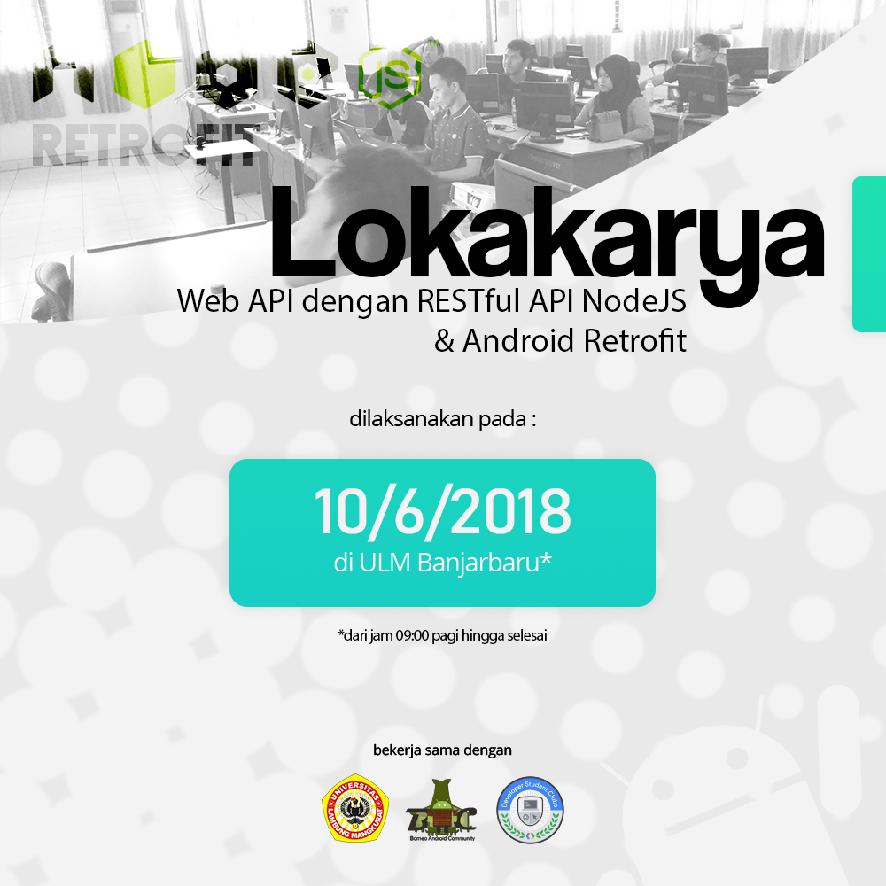

## Overview & Role Summary

Google Developer Student Clubs (GDSC) are university-based community groups supported by Google Developers for undergraduate and graduate students interested in Google developer technologies. As the inaugural Chapter Lead for Universitas Lambung Mangkurat (ULM) (2018 – 2019), I was responsible for founding the campus chapter, curating technical curriculum paths, and facilitating regular developer study jams.

## Key Initiatives & Community Leadership

- **Technical Workshop Delivery**: Organized monthly hands-on codelabs and technical sessions covering foundational Google technologies, including Google Cloud Platform (GCP) compute services, modern Android application development with Kotlin, and standard web APIs.
- **Collaborative Project Facilitation**: Led collaborative student programming cohorts where senior and junior computer science undergraduates paired up to build practical software projects addressing local campus and community challenges.
- **Developer Community Outreach**: Established the foundation of ULM's developer community, scaling student participation through structured peer mentoring and collaborative problem-solving circles.
