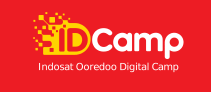

::link{url="https://idcamp.ioh.co.id/"}

## Overview & Role Summary

Indosat Ooredoo Digital Camp (IDCamp) is an industry-backed scholarship initiative organized by Indosat Ooredoo Hutchison in partnership with Dicoding (Google Authorized Training Partner). Designed to cultivate high-readiness Indonesian software engineering talent, the program provides intensive, practical curriculum tracks across software development domains.

Selected as a Technical Facilitator for the 2019 cohort following prior alumni distinctions across multiple Dicoding specialized tracks.

## Mentorship Responsibilities & Engineering Guidance

- **Direct Student Cohort Mentorship**: Guided a dedicated cohort of 20 students through a self-paced, rigorous digital web development curriculum.
- **Code Review & Architectural Feedback**: Conducted one-on-one code reviews on student project submissions, enforcing clean code principles, semantic HTML/CSS structuring, DOM manipulation standards, and asynchronous JavaScript patterns.
- **Troubleshooting & Algorithmic Debugging**: Hosted targeted office hours and discussion thread consultations to assist students in isolating syntax defects, logic errors, and API integration failures, significantly improving course completion rates.
