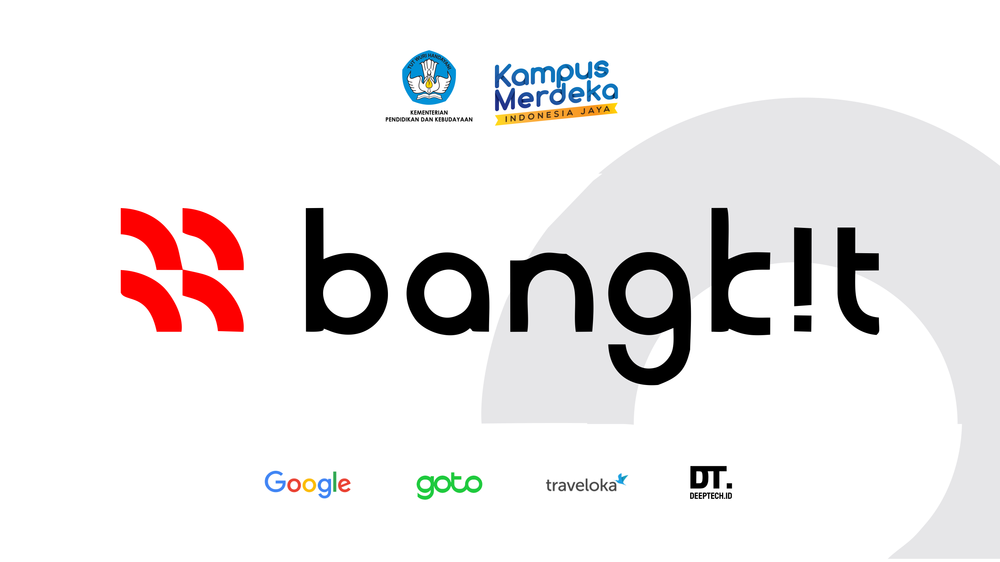

::link{url="https://grow.google/intl/id_id/bangkit/"}

## Overview & Role Summary

Bangkit is a career readiness program founded by Google, GoTo, and Traveloka, operated in collaboration with the Indonesian Ministry of Education, Culture, Research, and Technology (Kampus Merdeka). The 900-hour technical program trains university students across three primary learning tracks: Cloud Computing, Machine Learning, and Mobile Development.

Invited to serve as an Advisor for the 2021 cohort based on technical industry experience and alumni standing with Google Developer Student Clubs and Dicoding.

## Mentorship Responsibilities & Engineering Guidance

- **Cohort Mentorship**: Supported 20 learners through an intensive online curriculum, providing strategic guidance, clarifying advanced distributed systems concepts, and fostering disciplined problem-solving methodologies.
- **Capstone Project Advisory**: Supervised cross-functional teams during their final Capstone Projects. Evaluated system design proposals, API contract specifications, cloud infrastructure cost estimates, and client-server integration boundaries.
- **Code Quality & Production Readiness**: Provided systematic feedback on git workflows, Docker containerization, REST API standards, and machine learning inference pipeline deployments on Google Cloud Platform.
