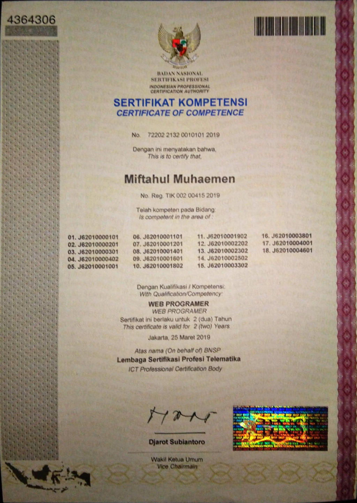
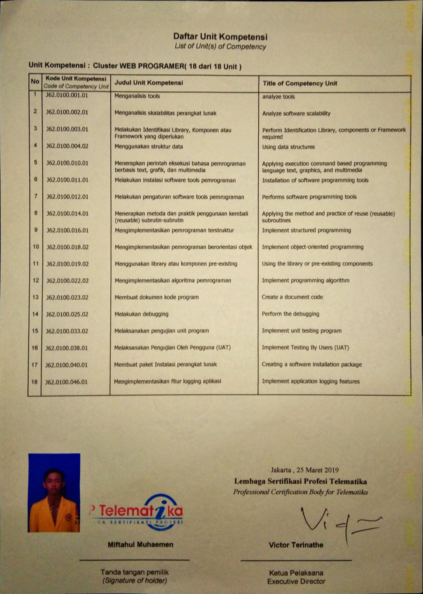

::link{url="https://drive.google.com/file/d/1rYMqBU9MmNPxd8ORHKI1im1Jn0qQzj8-/view"}

## Credential Verification and Validity

- **Issuing Authority**: Badan Nasional Sertifikasi Profesi (BNSP) via Lembaga Sertifikasi Profesi (LSP) Telematika
- **Issue Date**: March 25, 2019
- **Expiration Date**: March 25, 2021 (2-year standard validity period per SKKNI framework)
- **Certificate Number**: `72202 2132 0010101 2019`
- **Registration Number**: `TIK 002 00415 2019`
- **Credential Document**: [BNSP Certified Web Programmer Certificate](https://drive.google.com/file/d/1rYMqBU9MmNPxd8ORHKI1im1Jn0qQzj8-/view)

## Role and Skillset Alignment

- **Target Engineering Roles**: Junior Web Developer, Junior Fullstack Developer, Backend Software Engineer.
- **Validated Skillset & Competencies**:
  - **Structured & Object-Oriented Programming**: Applying OOP design patterns, algorithmic control flow, modular architecture, and variable scoping across server-side scripts.
  - **Relational Database Integration**: Executing Data Definition Language (DDL) and Data Manipulation Language (DML) statements, schema design, and establishing database connection pools.
  - **Client-Side Interface Implementation**: Semantic HTML structure, cascading stylesheets (CSS), and client-side JavaScript DOM event handling.
  - **Quality Assurance & Maintenance**: Executing systematic unit testing suites, debugging runtime exceptions, maintaining structured error logs, and writing technical system documentation per Indonesian National Work Competency Standards (SKKNI).

## Assessed Competency Units (SKKNI Matrix)

The certification assessment evaluated 18 discrete competency units, including:

1. `TIK.PR02.001.01`: Membuat Algoritma Pemrograman Tingkat Dasar
2. `TIK.PR02.002.01`: Membuat Algoritma Pemrograman Lanjut
3. `TIK.PR02.003.01`: Membuat Program Terstruktur
4. `TIK.PR02.004.01`: Mengoperasikan Bahasa Pemrograman Berorientasi Objek
5. `TIK.PR02.007.01`: Mengimplementasikan Rancangan Entitas dan Keterkaitan Data
6. `TIK.PR02.010.01`: Menggunakan Bahasa Pemrograman SQL Terstruktur
7. `TIK.PR02.014.01`: Melakukan Debugging
8. `TIK.PR02.015.01`: Membuat Dokumen Teknis Program
