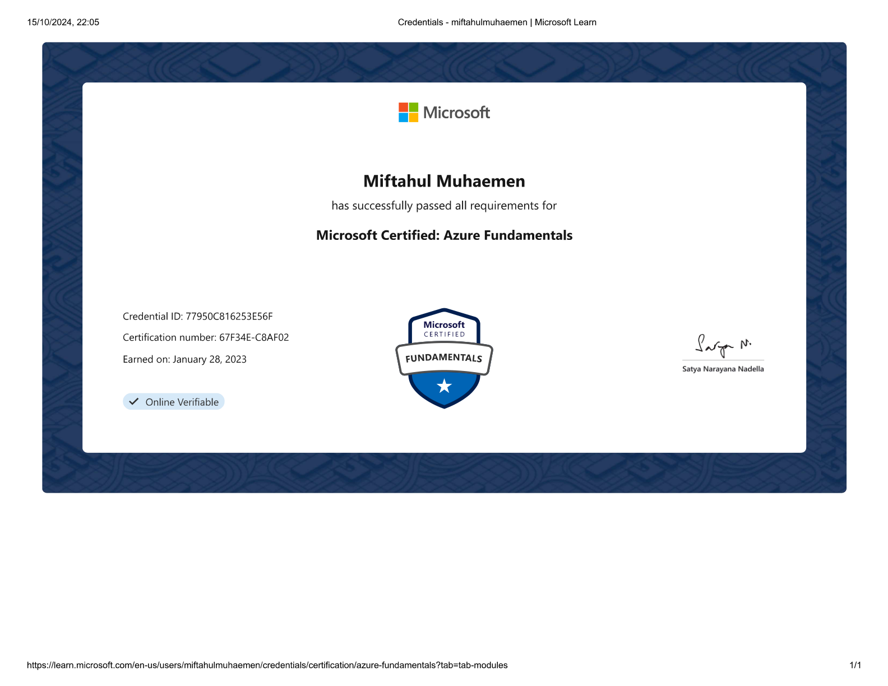

::link{url="https://www.credly.com/badges/fb5d02d3-566a-4373-83c3-b3c2f572fc0d/linked_in_profile"}

## Credential Verification and Validity

- **Issuing Organization**: Microsoft
- **Issue Date**: January 28, 2023
- **Expiration Date**: Does not expire (Lifetime credential)
- **Certification Number**: `67F34E-C8AF02`
- **Credential ID**: `77950C816253E56F`
- **Verification Portal**: [Credly Digital Badge Verification](https://www.credly.com/badges/fb5d02d3-566a-4373-83c3-b3c2f572fc0d/linked_in_profile)

## Role and Skillset Alignment

- **Target Engineering Roles**: Cloud Infrastructure Engineer, Systems Administrator, Junior DevOps Engineer, Technical Support Specialist.
- **Validated Skillset & Competencies**:
  - **Azure Core Architecture**: Resource hierarchy structure (Management Groups, Subscriptions, Resource Groups), geographical footprint (Regions, Availability Zones, Region Pairs).
  - **Compute, Storage, and Networking**: Provisioning Azure Virtual Machines, Azure Container Instances (ACI), Azure Kubernetes Service (AKS), Azure Virtual Networks, Subnets, Network Security Groups (NSGs), Azure Blob Storage tiers (Hot, Cool, Cold, Archive), and Azure Files.
  - **Identity, Access, and Security Governance**: Authentication and directory management through Microsoft Entra ID (formerly Azure Active Directory), Role-Based Access Control (RBAC) permission assignment, Azure Policy compliance enforcement, and Zero Trust architecture principles.
  - **Cost Management & Service Level Agreements**: TCO calculation, Azure Cost Management budgeting, Azure Advisor architectural assessments, and composite SLA calculation.

## Official Certification Overview

Demonstrates foundational mastery of cloud computing concepts and Microsoft Azure architecture, security, compliance, identity, and operational lifecycle management.
