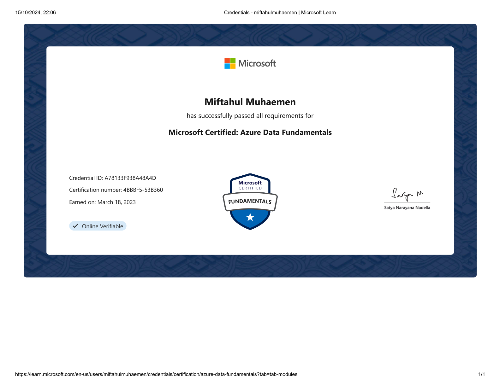

::link{url="https://www.credly.com/badges/90c5b341-73e5-4505-8636-d887319a2dd9/linked_in_profile"}

## Credential Verification and Validity

- **Issuing Organization**: Microsoft
- **Issue Date**: March 18, 2023
- **Expiration Date**: Does not expire (Lifetime credential)
- **Certification Number**: `4BBBF5-53B360`
- **Credential ID**: `A78133F938A48A4D`
- **Verification Portal**: [Credly Digital Badge Verification](https://www.credly.com/badges/90c5b341-73e5-4505-8636-d887319a2dd9/linked_in_profile)

## Role and Skillset Alignment

- **Target Engineering Roles**: Junior Data Engineer, Database Administrator, Analytics Engineer, Business Intelligence Developer.
- **Validated Skillset & Competencies**:
  - **Relational Data Management**: Relational schema design, normalization, ACID properties, index optimization, and provisioning managed databases (Azure SQL Database, Azure SQL Managed Instance, Azure Database for PostgreSQL).
  - **Non-Relational Datastores & Distributed NoSQL**: Document, key-value, and graph data modeling with Azure Cosmos DB; multi-region distribution; tuning consistency models (Strong, Bounded Staleness, Session, Consistent Prefix, Eventual).
  - **Modern Analytical Engines**: Analytical architecture design using Azure Synapse Analytics, dedicated vs. serverless SQL pools, Apache Spark integration, and Azure Data Lake Storage Gen2 (ADLS Gen2).
  - **Data Ingestion & Orchestration**: Designing batch and near real-time data pipelines with Azure Data Factory, data flow transformations, and streaming ingestion using Azure Event Hubs and Azure Stream Analytics.

## Official Certification Overview

Validates foundational understanding of core data workloads, relational and non-relational database services, modern data warehousing architectures, and real-time data analytics implementations on Microsoft Azure.
