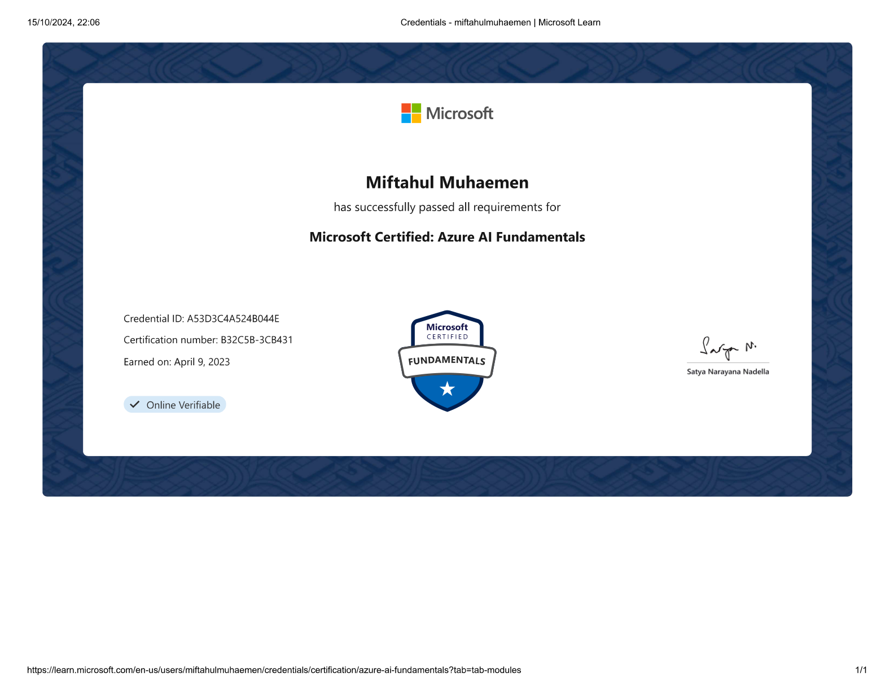

::link{url="https://www.credly.com/badges/6120a6d4-dbc0-4d1f-94f6-195b1667d48e/linked_in_profile"}

## Credential Verification and Validity

- **Issuing Organization**: Microsoft
- **Issue Date**: April 9, 2023
- **Expiration Date**: Does not expire (Lifetime credential)
- **Certification Number**: `B32C5B-3CB431`
- **Credential ID**: `A53D3C4A524B044E`
- **Verification Portal**: [Credly Digital Badge Verification](https://www.credly.com/badges/6120a6d4-dbc0-4d1f-94f6-195b1667d48e/linked_in_profile)

## Role and Skillset Alignment

- **Target Engineering Roles**: Applied AI Engineer, AI Solutions Specialist, Junior Machine Learning Engineer, Technical Product Specialist.
- **Validated Skillset & Competencies**:
  - **Machine Learning Foundations**: Supervised learning workflows (regression, classification), unsupervised clustering algorithms, model validation metrics (precision, recall, F1-score, AUC-ROC), automated ML (AutoML), and model operationalization via Azure Machine Learning.
  - **Computer Vision Workloads**: Image classification, multi-class object detection, semantic segmentation, spatial analysis, and optical character recognition (OCR) utilizing Azure AI Vision and Custom Vision services.
  - **Natural Language Processing (NLP)**: Named Entity Recognition (NER), key phrase extraction, document sentiment scoring, language detection, machine translation, and text-to-speech synthesis via Azure AI Language and Speech services.
  - **Conversational AI Frameworks**: Conversational agent architecture, intent and entity parsing, FAQ knowledge bases, and multi-turn dialog state machines via Azure Bot Service.
  - **Responsible AI Governance**: Adherence to the six Microsoft Responsible AI pillars: Fairness, Reliability & Safety, Privacy & Security, Inclusiveness, Transparency, and Accountability.

## Official Certification Overview

Validates fundamental knowledge of machine learning (ML) and artificial intelligence (AI) concepts, cognitive services integration, and Microsoft Azure cloud AI workloads.
