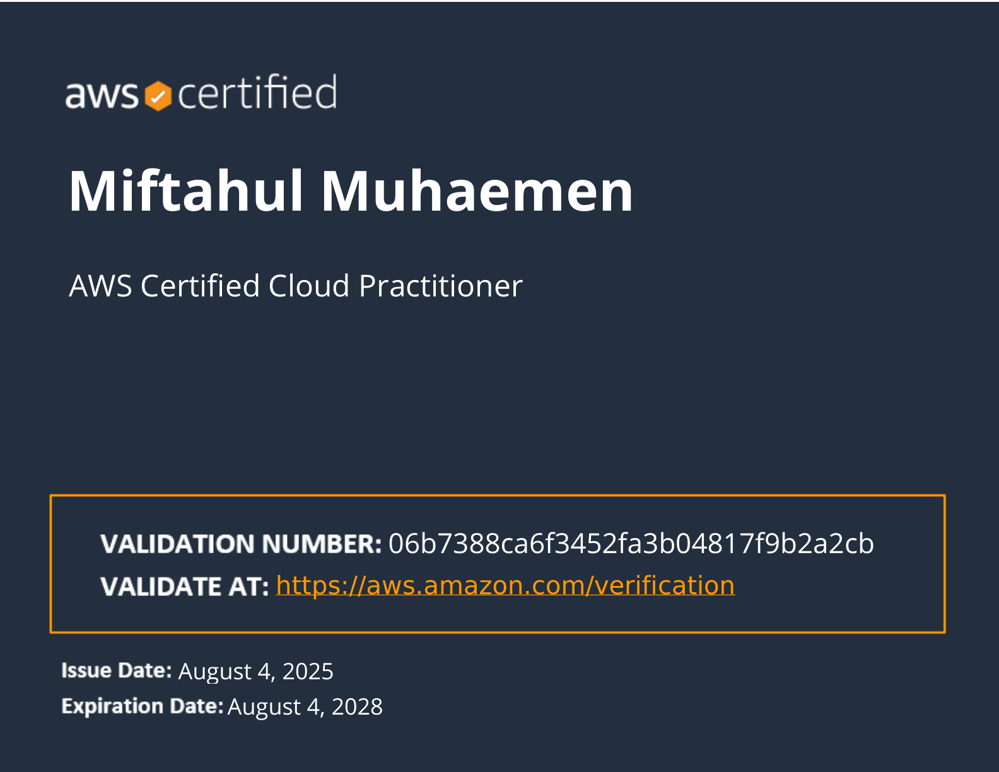

::link{url="https://www.credly.com/badges/29af2d37-1454-4451-829e-09c77914c0c7/linked_in_profile"}

## Credential Verification and Validity

- **Issuing Organization**: Amazon Web Services Training and Certification
- **Issue Date**: August 4, 2025
- **Expiration Date**: August 4, 2028
- **Validation Number**: `06b7388ca6f3452fa3b04817f9b2a2cb`
- **Verification Portal**: [AWS Certification Verification](https://aws.amazon.com/verification)

## Role and Skillset Alignment

- **Target Engineering Roles**: Cloud Support Engineer, Junior DevOps Engineer, Associate Solutions Architect, Backend Software Engineer.
- **Validated Skillset & Competencies**:
  - **Core Cloud Infrastructure**: Provisioning and evaluating foundational cloud services including compute (Amazon EC2, AWS Lambda), object and block storage (Amazon S3, EBS), and managed relational/NoSQL datastores (Amazon RDS, DynamoDB).
  - **Network Topology & Isolation**: Virtual Private Cloud (VPC) design, subnetting, Security Groups, Network ACLs, and edge routing with Amazon Route 53 and CloudFront.
  - **Security, Identity, and Governance**: Implementation of least-privilege policies via AWS Identity and Access Management (IAM), multi-factor authentication (MFA), AWS KMS encryption, and AWS Organizations service control policies (SCPs).
  - **Reliability & Well-Architected Framework**: Architectural best practices spanning the operational excellence, security, reliability, performance efficiency, and cost optimization pillars.
  - **Billing & Cloud Financial Governance**: Cost monitoring, budget threshold alerts, and usage analysis through AWS Cost Explorer, AWS Budgets, and AWS Pricing Calculator.

## Official Certification Overview

Earners of this credential have demonstrated comprehensive foundational knowledge of cloud concepts, security practices, core AWS services, and billing frameworks. Issued under the AWS re/Start initiative to validate readiness for cloud engineering roles.
