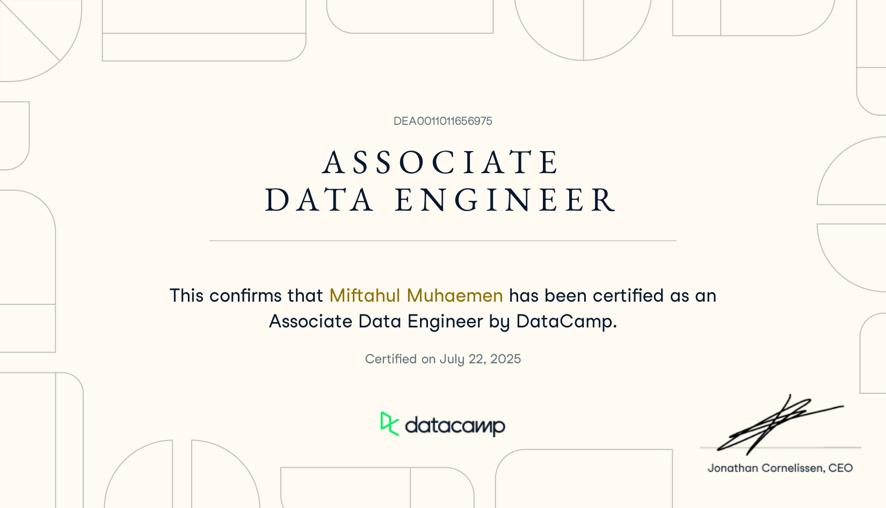

::link{url="https://www.datacamp.com/certificate/DEA0011011656975"}

## Credential Verification and Validity

- **Issuing Organization**: DataCamp
- **Issue Date**: July 22, 2025
- **Expiration Date**: Does not expire (Lifetime verification)
- **Certificate ID**: `DEA0011011656975`
- **Verification Portal**: [DataCamp Certificate Verification](https://www.datacamp.com/certificate/DEA0011011656975)

## Role and Skillset Alignment

- **Target Engineering Roles**: Associate Data Engineer, Analytics Engineer, ETL Pipeline Developer, Database Administrator.
- **Validated Skillset & Competencies**:
  - **Data Warehousing & Dimensional Modeling**: Implementation of star schemas, snowflake schemas, fact tables, dimensional hierarchies, and slowly changing dimensions (SCD) for analytical workloads.
  - **SQL Query Optimization & Data Manipulation**: Advanced relational transformations with PostgreSQL, window functions, partitioned aggregations, CTEs, subquery refactoring, and indexing strategies.
  - **Data Cleansing & Exploratory Validation**: Automated identification of structural schema defects, inconsistent data types, duplicate records, null constraint violations, and distribution anomalies.
  - **ETL/ELT Architecture**: Pipeline orchestration principles, staging intermediate datasets, schema enforcement, idempotent pipeline execution, and data contract validation.

## Assessment Format

Certification awarded upon successful completion of a timed theoretical examination and a timed practical data engineering coding assessment evaluated against automated unit tests and data contract compliance.
