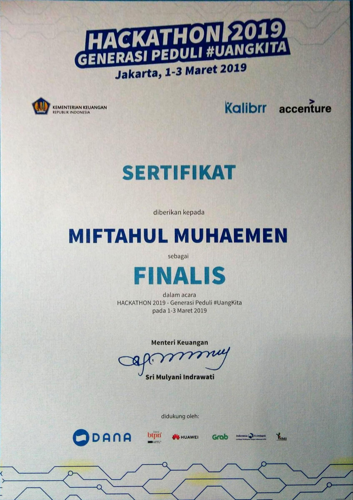

::link{url="https://drive.google.com/file/d/1RAcAL0x7BtcHTC-G2K-bAq0F9T1iuU6O/view?usp=sharing"}

## Credential Verification and Validity

- **Issuing Entity**: Kementerian Keuangan Republik Indonesia (Ministry of Finance Republic of Indonesia)
- **Event Date**: March 2019
- **Validity**: Lifetime distinction (Competitive hackathon achievement)
- **Credential Document**: [Certificate of Participation & Finalist Presentation](https://drive.google.com/file/d/1RAcAL0x7BtcHTC-G2K-bAq0F9T1iuU6O/view?usp=sharing)

## Role and Skillset Alignment

- **Target Engineering Roles**: Product Engineer, Rapid Prototyping Developer, Fullstack Engineer, Fintech Solutions Engineer.
- **Validated Skillset & Competencies**:
  - **Rapid MVP Engineering Under Strict Constraints**: Scoping, designing, and delivering a functional, interactive application prototype within a 24-hour sprint window.
  - **Cross-Functional Team Integration**: Collaborating in an agile pod comprising one software engineer, one UI/UX designer, and one business/product strategist to align technical architecture with user problem statements.
  - **Fintech Domain Translation**: Abstracting public finance and state budget (APBN) data into interactive, intuitive consumer-facing digital workflows to improve national financial literacy.
  - **Executive Technical Defense**: Delivering a high-stakes technical pitch, product demonstration, and viability defense directly to executive leadership, including the Minister of Finance of Indonesia, Sri Mulyani Indrawati.

## Event Overview

Organized by the Ministry of Finance of Indonesia, Hackathon Generasi Peduli #UangKita challenged multidisciplinary teams across the nation to pioneer technological solutions that drive public understanding of national fiscal policy, state budget allocation, and personal financial literacy.
