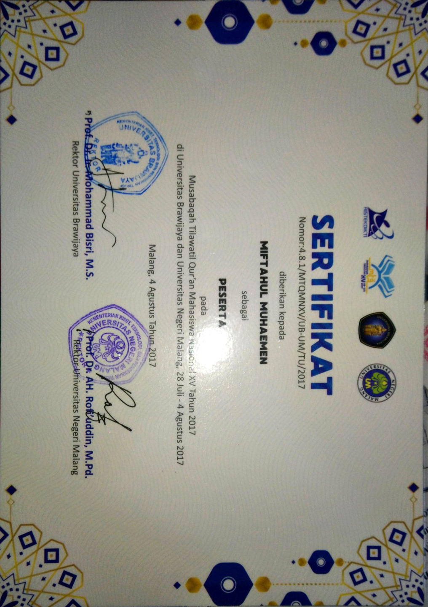

::link{url="https://drive.google.com/file/d/1Kz6VZ7IPye8x2r7Dxp113S9UuhEaIfeq/view?usp=sharing"}

## Credential Verification and Validity

- **Issuing Entity**: Kementerian Riset, Teknologi, dan Pendidikan Tinggi (Kemenristekdikti) RI, hosted by Universitas Brawijaya and Universitas Negeri Malang
- **Event Dates**: July 28 – August 4, 2017
- **Validity**: Lifetime distinction (National collegiate competition finalist)
- **Credential Document**: [Certificate of Participation - Mobile Application Category](https://drive.google.com/file/d/1Kz6VZ7IPye8x2r7Dxp113S9UuhEaIfeq/view?usp=sharing)

## Role and Skillset Alignment

- **Target Engineering Roles**: Mobile Application Developer, Junior Cross-Platform Engineer, Frontend Engineer.
- **Validated Skillset & Competencies**:
  - **Cross-Platform Mobile Architecture**: Architecting mobile views, local state handling, and application lifecycles with C# and .NET using Microsoft Visual Studio and Xamarin.
  - **Text and Media Processing**: Engineering local storage indexing, search mechanisms for script text, and audio playback synchronization for multi-chapter religious literature.
  - **Competitive Technical Presentation**: Co-designing system architecture walk-throughs, user flow demonstrations, and defending engineering trade-offs before a national academic jury.

## Event Overview

The 15th National Student Qur'an Recitation Competition (MTQMN XV) is a premier biennial national collegiate competition organized by Kemenristekdikti. Represented Universitas Lambung Mangkurat (ULM) in the Computer Science Mobile Application Design category alongside senior undergraduate engineering peers.
