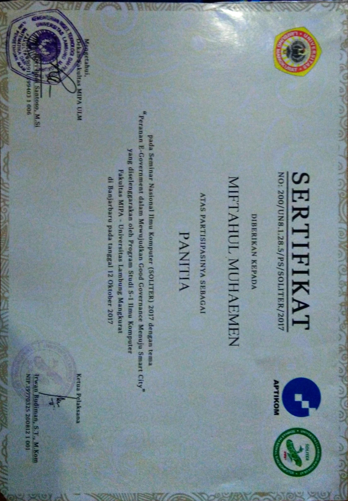

::link{url="https://drive.google.com/file/d/1Kz7lRJPVjkUAcOsljArbcPpNfZGFkImf/view?usp=sharing"}

## Overview & Role Summary

The National Computer Science Seminar (SOLITER) 2017 was a regional academic and governmental conference hosted by the Computer Science Department, Faculty of Mathematics and Natural Sciences (FMIPA) at Universitas Lambung Mangkurat. The conference theme focused on "The Role of E-Government in Realizing Good Governance Towards Smart City".

Served as an active member of the technical organizing committee responsible for event execution and operational logistics.

## Key Responsibilities & Execution

- **Technical Staging & AV Coordination**: Managed multimedia hardware, presentation projection feeds, and audio-visual setups across multiple presentation auditoriums for keynote speakers and technical paper authors.
- **Logistics & Speaker Liaison**: Coordinated scheduling, room allocations, and direct operational support for distinguished university researchers, municipal IT directors, and regional government stakeholders.
- **Audience Operations**: Supported the registration and technical proceedings for over 200 registered delegates, ensuring zero schedule drift across morning keynotes and afternoon technical paper tracks.
