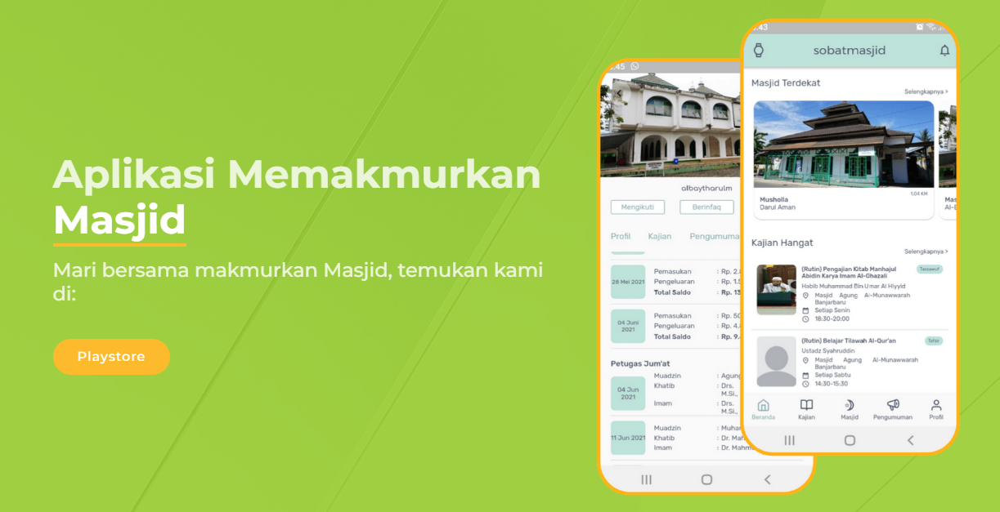

- [x] Web Platform Live
- [x] Native Android Client Preserved in Repository

::link{url="https://sobatmasjid.com/"}

## Overview

Sobat Masjid is a community mobile application designed to connect mosque administrators (_Dewan Kemakmuran Masjid / DKM_) with neighborhood congregants. Traditional mosque communication often relies on physical noticeboards or fragmented messaging groups, leading to missed prayer events, lack of financial transparency, and uncoordinated volunteer activities.

As the dedicated Android Engineer, I engineered the native mobile client in Kotlin to centralize mosque services, schedule notifications, broadcast announcements, and publish transparent financial statements directly to worshippers.

## Architecture and Technical Implementation

### 1. MVVM Architecture and Native Android Stack

The application is structured around Android Jetpack architectural patterns:

- **Clean Architecture & MVVM**: Separation of concerns utilizing `ViewModel`, `LiveData`, and `DataRepository` layers to manage asynchronous state and survive configuration changes.
- **Coroutines & Asynchronous Processing**: Kotlin Coroutines dispatch API calls off the main UI thread, ensuring fluid 60 FPS scrolling across high-density announcement feeds and prayer schedules.
- **Custom View Components**: Modular UI components leveraging `BaseBottomSheetFragment` and `BaseBottomTabFragment` for modal prayer selectors and account settings.

### 2. Networking and REST API Integration

- **Retrofit 2 HTTP Client**: Configured with custom `BasicAuthInterceptor` authentication headers and OkHttp logging for secure API interactions with the backend service.
- **Dynamic Mosque Filtering & Geolocation**: Uses Android Location Services to resolve device GPS coordinates, calculating proximity distances to nearby mosques and sorting discovery feeds dynamically.

### 3. Core Community Features

- **Adhan & Prayer Times Engine**: Algorithmic prayer calculation using latitude, longitude, and timezone offsets, complete with local alarm scheduling and audio playback.
- **Financial Transparency Ledger**: A dedicated reporting module displaying verified ledger income and expense statements, promoting accountability for community donations.
- **Friday Prayer Rosters & Officer Management**: Real-time schedules for Khatib (preachers), Imams, and Mu'adhin with advance notifications.
- **Push Notification Broadcasts**: Integrated Firebase Cloud Messaging (FCM) to deliver urgent community bulletins and disaster relief announcements.

## Repository

::github{repo="miftahulmuhaemen/SobatMasjid"}
