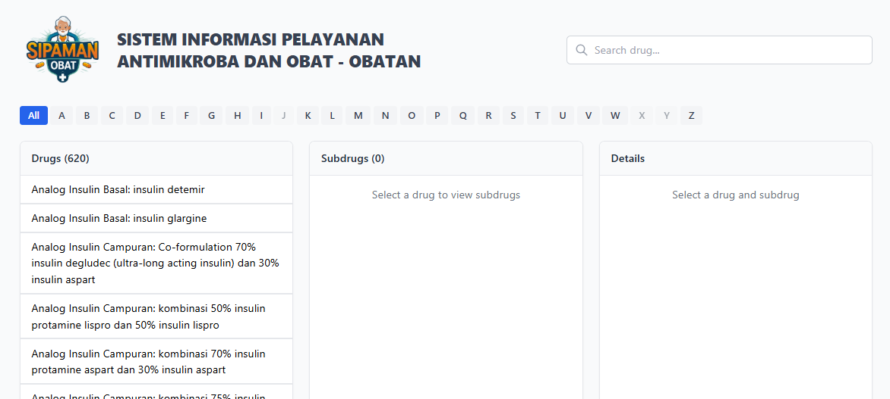

- [x] Server Alive
- [x] Production System in Active Operation

::link{url="https://sipamanobat.my.id/"}

## Overview

In Indonesian healthcare facilities, pharmacists must verify national formulary (_e-Fornas Kemkes_) rules, maximum prescription limits, therapeutic classes, and special dispensing restrictions before releasing medication to patients. The official government portal presents high friction and omits operational dispensing criteria, forcing clinical pharmacists to cross-reference multiple disparate PDFs and institutional documentation.

Sipamanobat is an enriched pharmaceutical glossary web application. It indexes national formulary medications and pairs them with critical dispensing constraints, therapeutic classifications, and prescription restrictions in an instantaneous, searchable interface.

## Architecture and Technical Implementation

### 1. Automated Extraction Pipeline

The data pipeline extracts and enriches pharmaceutical records through automated web scraping:

- **Automated Web Scraping**: A Python pipeline powered by Selenium navigates and extracts drug records from the Ministry of Health portal (`https://e-fornas.kemkes.go.id/guest/daftar-obat`).
- **Data Normalization**: Raw HTML tables and modal dialogs are parsed, cleansed, and normalized into a single static JSON schema (`data/data.json`). The schema structures active ingredients, dosage strengths, therapeutic classes, sub-classes, institutional service tiers (FKTP/FKRTL), and specific prescription restrictions.

### 2. Client-Side Instant Search Architecture

The frontend is built with React 18, TypeScript, Vite, and Tailwind CSS:

- **Zero-Latency In-Memory Filtering**: Rather than incurring network roundtrips to an API server for every keystroke, the client preloads the static JSON dataset directly into browser memory.
- **Multi-Attribute Search & Alphabetical Indexing**: Pharmacists can filter drugs via quick A-Z index tabs or perform instant text searches matching generic names, brand variants, or therapeutic indications simultaneously.
- **Structured Specification View**: Selecting a drug line item immediately populates an itemized specifications card detailing dosage form, strength, maximum prescription limits, and regulatory constraints.

### 3. Edge Delivery and Privacy-Preserving Telemetry

- **Static Edge Hosting**: Deployed as an optimized static build to GitHub Pages and proxied through Cloudflare CDN with automated SSL and asset minification under the custom domain `sipamanobat.my.id`.
- **Privacy-Preserving Analytics**: Integrated GoatCounter telemetry (`sipamanobat.goatcounter.com`) to track catalog usage without harvesting cookies or personal identifiable information (PII).

## Repository

::github{repo="miftahulmuhaemen/drugstore-glossary"}
