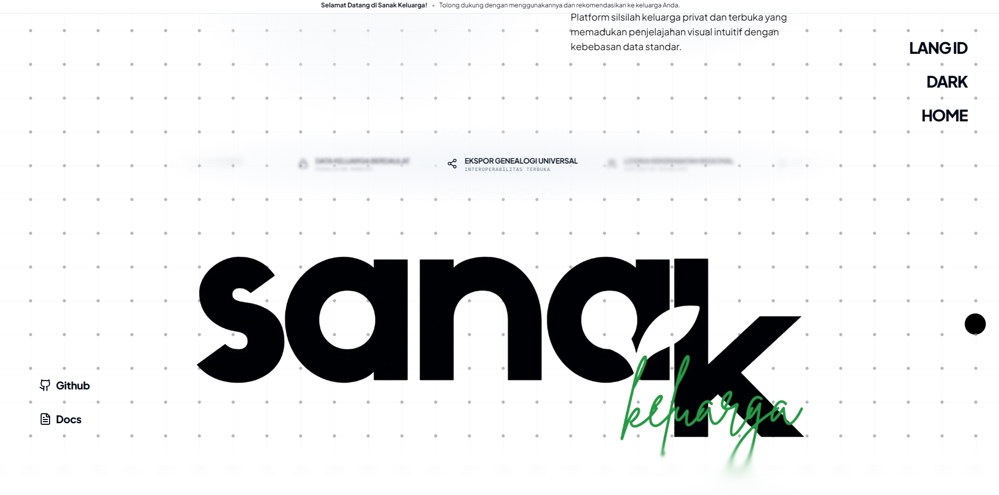
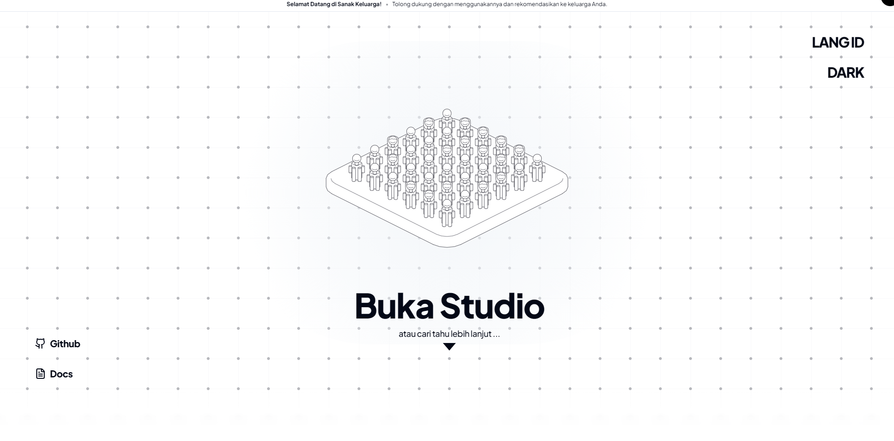

- [x] Server Alive
- [x] Actively Maintained

::link{url="https://sanak.muhaemen.my.id/"}

## Overview

Sanak Keluarga is an interactive family lineage management and genealogy visualization platform. Most existing genealogy tools either force user data into proprietary cloud lock-in or present clunky interfaces that fail to represent non-Western kinship structures effectively.

Sanak Keluarga bridges this divide by combining an offline-first, client-side visual graph canvas with bi-directional synchronization against the universal GEDCOM 5.5.1 genealogy specification. The application operates entirely inside the browser sandbox, prioritizing user privacy while offering cloud synchronization capabilities through Google Drive.

## Interactive Demonstration

## Architecture and Technical Implementation

### 1. Universal Format Compatibility & Live Code Editor

The platform implements industry-standard GEDCOM 5.5.1 compliance with an integrated Monaco code editor:

- **Two-Way State Synchronization**: Edits made in the visual node canvas instantaneously reflect in the Monaco text buffer, and direct text changes in the GEDCOM buffer re-render the hierarchical tree in real time.
- **AST Parsing and Validation**: A dedicated AST parser parses raw lineage records (`INDI`, `FAM`, `CHIL`, `HUSB`, `WIFE`), flags syntax errors, and resolves node references before graph updates.

### 2. Generational Visual Canvas & Kinship Path Finder

Visualizing complex, multi-generational families requires custom graph layout and traversal mechanics:

- **Generational Hierarchy Engine**: Dynamic topological sorting calculates generational tiers and branch spacing, preventing cross-generational link overlap.
- **Vantage-Point Addressing**: Users can designate any individual as the vantage point, dynamically recalculating relative kinship paths and generational distances across parent, sibling, and collateral branches.
- **Interactive Navigation**: Pan, zoom, and viewport focus controls allow seamless navigation across large trees containing hundreds of individuals.

### 3. Private Local Storage & Cloud Synchronization

- **Client-Side Sandbox**: Built with browser IndexedDB, all genealogical records are stored entirely on the client device without telemetry or third-party database exposure.
- **Google Drive Storage Provider**: Users can link their Google Drive accounts via OAuth 2.0 to export, back up, and synchronize family files across multiple devices without intermediary servers.

### 4. Rich Profiles & Customary Regional Kinship Addressing

- **Extended Lineage Metadata**: Profiles support burial ground coordinates with direct Google Maps navigation links, verified birth/death records, and WhatsApp communication shortcuts.
- **Indonesian Kinship Nomenclature**: Native dictionary engine resolving traditional Indonesian address terms across regional customs, including Banjar, Dayak, Javanese, Sundanese, Minang, and Batak traditions.

## Deployment & Delivery

The application is bundled using Vite and deployed globally on **Cloudflare Pages**, delivering static assets with zero cold starts, automated preview environments for pull requests, and automated caching at edge points of presence.

## Repository

::github{repo="miftahulmuhaemen/family-tree"}
