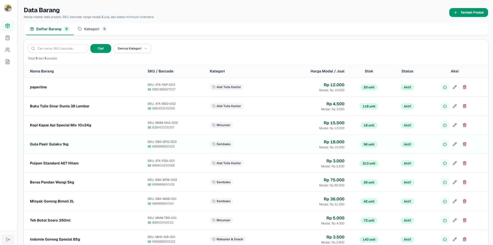

- [x] Server Alive
- [x] Production System in Active Operation

::link{url="https://koperasi-khmb.cloud/"}

## Overview

Koperasi Konsumen Harum Manis Bersatu (KHMB) is a retail consumer cooperative requiring continuous sales transactions and precise inventory tracking. Traditional retail POS systems often falter under intermittent network connectivity or introduce excessive administrative overhead for inventory reconciliation.

This platform provides an offline-first Point of Sale (POS) and inventory management system designed for physical retail reliability. It pairs a high-throughput Go backend with a responsive React client, enabling uninterrupted cashier checkout operations while maintaining strict back-office auditability, stock expiration tracking, and multi-tier role-based security.

## Architecture and Technical Implementation

### 1. Offline-First POS Engine and State Synchronization

The cashier terminal operates on an offline-first architecture powered by Dexie.js over browser IndexedDB:

- **Local Transaction Buffer**: Sales transactions are recorded instantly to IndexedDB with unique UUIDs. Cashiers process checkouts, apply quantity discounts, and calculate change without network roundtrips.
- **Background Delta Sync**: A background worker polls network availability and flushes queued transactions to the backend in batches. Every sync payload includes an idempotency key to prevent double-charging or duplicate inventory deductions during flaky connectivity.
- **Optimistic Stock Caches**: Critical master catalog data, barcodes, and pricing tiers are cached locally and refreshed via incremental deltas.

### 2. High-Performance Go Backend

The backend is built with Go 1.22 and the Echo v4 web framework, following clean architectural boundaries (Handlers, Services, Repositories, Models):

- **Database Design and Indexing**: Structured on PostgreSQL 14+, high-frequency catalog searches use specialized B-tree indexes with `varchar_pattern_ops` for fast prefix lookups on barcodes and SKUs.
- **Aggregated Summaries**: Daily stock movements use single-pass Common Table Expressions (CTEs) to pre-aggregate balances into `daily_stock_summary` tables, cutting query latency on historical reports by over 70%.
- **Subquery Pushdown**: Stock movement histories with `UNION ALL` partitions utilize bounded subquery pushdowns to prevent full-table scans across large historical datasets.

### 3. Hardware Integration & Peripherals

- **Hardware Barcode Scanners**: Global keystroke-interception heuristics differentiate human typing from high-speed USB/Bluetooth barcode scanner HID bursts. Barcode reads immediately update cart quantities and trigger audio confirmation via the Web Audio API without UI lag.
- **Thermal Receipt Printing**: Native direct printing over WebSerial and WebUSB with raw ESC/POS commands, providing instant receipt output with fallback to browser print dialogs.

### 4. Role-Based Access Control (RBAC) & Boundary Enforcement

The system strictly enforces route boundaries between retail checkout staff and cooperative administrators:

- **Cashier Mode (`/kasir`)**: Dedicated full-screen POS terminal optimized for rapid keyboard and scanner operation. Back-office URLs, wholesale cost margins, and financial reports are completely inaccessible to cashier tokens.
- **Admin Management (`/barang`, `/stok`, `/staf`, `/laporan`)**: Back-office suite managing SKU generation, supplier directories, inbound stock receipt with batch expiration tracking (`expired_date`), staff provisioning, and Excel data exports.

## Quality Assurance & Observability

To ensure reliability across retail peak hours:

- **Comprehensive Automated Testing**: Table-driven unit tests in Go covering business logic, complemented by Vitest for frontend components and custom hooks.
- **Gremlins Mutation Testing**: Mutation testing runs against backend service and repository layers to verify test suite assertion strength against edge cases.
- **End-to-End Workflows with Playwright**: Headless Chrome test suites validate full operational paths from barcode scans and cash/QRIS checkouts to downstream inventory deduction and financial report reconciliation.
- **k6 Load and Spike Testing**: Rigorous load testing verifying backend resilience against sudden burst traffic, breakpoint limits, and concurrent sync flushes.
- **Observability and Structured Logging**: Integrated Sentry SDK for full-stack error tracking, paired with Go standard library `log/slog` structured logging that injects `X-Request-ID` headers across all HTTP lifecycles.

## Deployment & Operations

The application runs in a containerized Docker stack orchestrated via Dokploy:

- Multi-stage Alpine Docker container running Go migrations (`cmd/migrate`) and automatic administrator seeding (`cmd/initadmin`).
- Multi-stage Bun + Nginx container serving Vite production bundles and reverse-proxying API traffic.
- Cloudflare CDN edge routing with automated Backblaze B2 S3 encrypted database snapshots.

## Repository

::github{repo="Tritiya-Teknologi/kasir-koperasi-khmb"}
