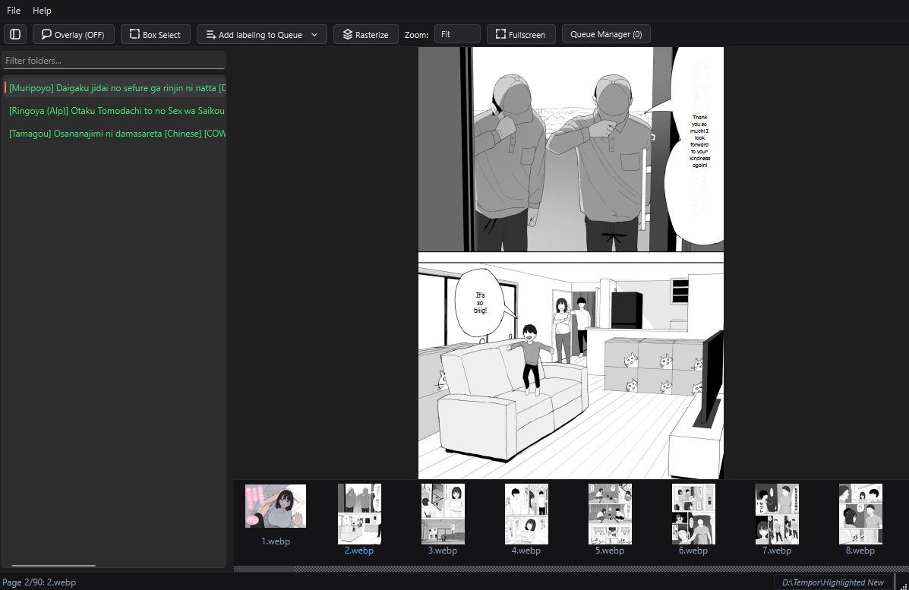
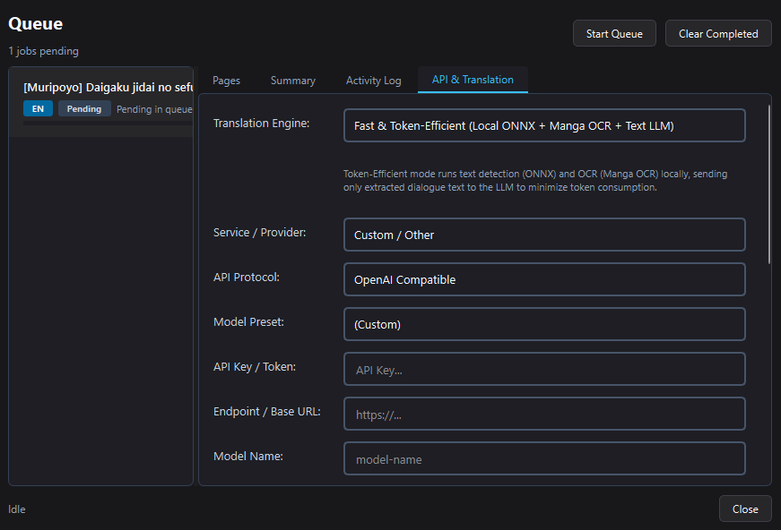

- [x] Application Active & Maintained
- [x] 100% Offline-First Local Detection

::link{url="https://komashift.muhaemen.my.id/"}

## Overview

KomaShift is a modern desktop comic reader, library organizer, and context-aware AI translation application for Windows. Reading raw or foreign-language manga typically forces collectors to choose between clunky multi-step translation tools that permanently smudge original artwork or rigid, word-by-word machine translators that fail to understand conversational context across panels.

KomaShift solves this by pairing high-performance local comic navigation with an on-demand, non-destructive AI translation pipeline. Readers can browse nested subdirectories seamlessly, detect speech bubbles and OCR text 100% offline, leverage their own AI subscriptions or local LLMs to generate contextually coherent dialogue, proofread and edit overlays in real time, and permanently finalize clean image chapters with a single click.

## Architecture and Technical Implementation

### 1. High-Performance Local Reader & Directory Engine

Built with PyQt6 and a hardware-accelerated QGraphicsView canvas, the reader prioritizes immediate responsiveness across large collections:

- **Instant Recursive Scanning**: Directly points to any root manga folder, surfacing deeply nested subdirectories and remembering reading position, library structure, and page history across sessions without requiring database importing.
- **Continuous Reading with Lock-In Zoom**: Reaching the final page of a chapter smoothly transitions into the first page of the adjacent folder. Custom zoom levels and fit modes remain locked across folder boundaries without viewport resetting.
- **Asynchronous Thumbnail Pipeline**: Thumbnails render via non-blocking background workers, populating the bottom navigation strip smoothly without causing frame drops or UI stuttering during high-speed page scrolling.

### 2. Neural Bubble Detection & Offline Japanese OCR

To maintain strict privacy and zero runtime latency, visual detection runs completely on device hardware:

- **Switchable Local ONNX Models**: Speech bubble contours are segmented using local ONNX Runtime models, eliminating coordinate drift and allowing readers to swap models optimized for different art styles, resolutions, and panel densities.
- **Local Character Recognition**: Offline Japanese character extraction powered by Manga OCR. Text extraction executes entirely on the local machine with zero external network requests.

### 3. Context-Aware AI Translation & BYO AI Integration

Conventional machine translation translates individual speech bubbles in isolation, losing character voices, gender markers, and narrative context. KomaShift introduces a context-first translation workflow:

- **Multi-Bubble Contextual Windows**: Dialogue is bundled with surrounding scene information and sent to Large Language Models (LLMs) to preserve conversational flow, tone, and character relationships across panels.
- **Bring Your Own AI (BYOK)**: Supports any standard OpenAI-compatible endpoint. Users connect their existing API keys (OpenAI, Gemini, Anthropic, OpenRouter) or run 100% private, offline models via local runtimes like Ollama and LM Studio.
- **Dual Translation Modes**: Readers can choose **Token-Efficient Mode** (local ONNX + local OCR + text LLM for ultra-low token cost) or **Visual Hybrid Mode** (vision LLMs for direct scene comprehension and artistic text recognition).

### 4. Interactive Staging Overlays & Permanent Finalization

Rather than immediately overwriting source artwork, KomaShift treats translation as an interactive draft canvas:

- **Crisp Vector Overlays**: Translated text dynamically calculates bubble contour bounds and auto-wraps vector typography with clean contrast styling. Tapping the `T` key instantly toggles between translation overlays and original raw artwork.
- **Quick In-Place Proofreader**: Clicking any detected bubble opens an inline text editor. Readers can adjust awkward phrasings, correct OCR typos, or manually insert translations for missed speech bubbles before finalizing.
- **One-Click Rasterization**: Once the proofreading draft is verified, pressing `Ctrl+B` bakes the vector text into flat, high-resolution image files in a sibling folder, ready for distribution, tablets, or web readers while preserving the original raw files untouched.

### 5. Dedicated Asynchronous Queue Manager & Safety Safeguards

- **Bottleneck-Free Background Queue**: All compute-heavy operations—neural bubble segmentation, OCR extraction, and network API requests—are processed through a dedicated worker queue with pause, resume, and rate-limiting controls to ensure the reader UI remains fluid at 60 FPS.
- **Batch Organization & Safe Trash**: Integrated batch folder renaming with side-by-side diff previews, paired with Send2Trash integration to ensure any folder deletions route strictly through the Windows Recycle Bin.

## Deployment & Delivery

- **Desktop Application**: Distributed as a standalone, portable 64-bit Windows executable built with PyQt6, bundling runtime models with no external Python installation required.
- **Web Presence**: The official landing page is built with Astro and Bun, statically generated and hosted globally on **Cloudflare Pages** edge infrastructure with custom domain routing at `komashift.muhaemen.my.id`.

## Repository

::github{repo="miftahulmuhaemen/komashift"}
